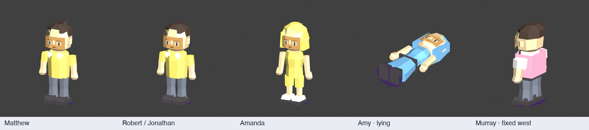

# Model index

One row per authored model. Repeated NPC IDs use the same file.

| Model | Triangles | Blender source | NPC IDs |
|---|---:|---|---|
| Dr Mason | 718 | [dr_mason.blend](assets/models/dr_mason/dr_mason.blend) | `DRMASON`, `05`, `06` |
| Ronald | 728 | [ronald.blend](assets/models/ronald/ronald.blend) | `RONALD1`, `RONALD2`, `RONALD3` |
| Ishihara | 804 | [ishihara.blend](assets/models/ishihara/ishihara.blend) | `ISHIHARA` |
| Imakuni | 518 | [imakuni.blend](assets/models/imakuni/imakuni.blend) | `IMAKUNI` |
| Tech | 663 | [tech.blend](assets/models/tech/tech.blend) | `SAM`, `TECH1`, `TECH2`, `TECH3`, `TECH4`, `TECH5`, `TECH6`, `JOSEPH`, `DAVID`, `ERIK`, `SPECS2`, `AARON`, `TECH7`, `TECH8` |
| Clerk | 686 | [clerk.blend](assets/models/clerk/clerk.blend) | `CLERK1`, `CLERK2`, `CLERK3`, `CLERK4`, `CLERK5`, `CLERK6`, `CLERK7`, `CLERK8`, `CLERK9`, `CLERK10`, `GIFT_CENTER_CLERK` |
| Mania | 578 | [mania.blend](assets/models/mania/mania.blend) | `CHRIS`, `MICHAEL`, `MATTHEW`, `MANIA`, `CHAMP` |
| Lass3 | 730 | [lass3.blend](assets/models/lass3/lass3.blend) | `JESSICA`, `LASS5` |
| Mitch | 610 | [mitch.blend](assets/models/mitch/mitch.blend) | `MITCH` |
| Boy | 578 | [boy.blend](assets/models/boy/boy.blend) | `RYAN`, `ROBERT`, `JONATHAN`, `LAD2` |
| Man | 582 | [man.blend](assets/models/man/man.blend) | `ANDREW`, `MAN1`, `MAN2`, `MAN3`, `GUIDE` |
| Gene | 761 | [gene.blend](assets/models/gene/gene.blend) | `GENE` |
| Swimmer | 584 | [swimmer.blend](assets/models/swimmer/swimmer.blend) | `SARA`, `AMANDA` |
| Joshua | 688 | [joshua.blend](assets/models/joshua/joshua.blend) | `JOSHUA` |
| Amy | 584 | [amy.blend](assets/models/amy/amy.blend) | `AMY` |
| Girl | 760 | [girl.blend](assets/models/girl/girl.blend) | `JENNIFER`, `BRITTANY`, `STEPHANIE` |
| Hood | 524 | [hood.blend](assets/models/hood/hood.blend) | `NICHOLAS`, `BRANDON`, `HOOD1`, `HOOD2` |
| Isaac | 669 | [isaac.blend](assets/models/isaac/isaac.blend) | `ISAAC` |
| Lass2 | 636 | [lass2.blend](assets/models/lass2/lass2.blend) | `KRISTIN`, `LASS1`, `LASS2` |
| Lass1 | 624 | [lass1.blend](assets/models/lass1/lass1.blend) | `HEATHER`, `LASS3`, `LASS4` |
| Nikki | 584 | [nikki.blend](assets/models/nikki/nikki.blend) | `NIKKI` |
| Lad | 662 | [lad.blend](assets/models/lad/lad.blend) | `DANIEL`, `JOHN`, `LAD1`, `LAD3` |
| Murray | 802 | [murray.blend](assets/models/murray/murray.blend) | `MURRAY1`, `MURRAY2` |
| Rick | 669 | [rick.blend](assets/models/rick/rick.blend) | `RICK` |
| Specs | 589 | [specs.blend](assets/models/specs/specs.blend) | `ADAM`, `SPECS1`, `SPECS3` |
| Ken | 797 | [ken.blend](assets/models/ken/ken.blend) | `KEN` |
| Courtney | 672 | [courtney.blend](assets/models/courtney/courtney.blend) | `COURTNEY` |
| Steve | 832 | [steve.blend](assets/models/steve/steve.blend) | `STEVE` |
| Jack | 663 | [jack.blend](assets/models/jack/jack.blend) | `JACK` |
| Rod | 807 | [rod.blend](assets/models/rod/rod.blend) | `ROD` |
| Woman | 584 | [woman.blend](assets/models/woman/woman.blend) | `WOMAN1`, `WOMAN2` |
| Chap | 804 | [chap.blend](assets/models/chap/chap.blend) | `CHAP1`, `CHAP2`, `CHAP3`, `CHAP4`, `CHAP5` |
| Gal | 556 | [gal.blend](assets/models/gal/gal.blend) | `GAL1`, `CLERK12`, `CLERK13`, `HOST`, `GAL2`, `GAL3`, `GAL4` |
| Pappy | 794 | [pappy.blend](assets/models/pappy/pappy.blend) | `PAPPY1`, `PAPPY2`, `PAPPY3` |
| Butch | 590 | [butch.blend](assets/models/butch/butch.blend) | `BUTCH` |
| Granny | 818 | [granny.blend](assets/models/granny/granny.blend) | `GRANNY1`, `GRANNY2` |
| Torch | 68 | [torch.blend](assets/models/torch/torch.blend) | `TORCH` |
| Legendary Card | 128 | [legendary_card.blend](assets/models/legendary_card/legendary_card.blend) | `LEGENDARY_CARD_TOP_LEFT`, `LEGENDARY_CARD_TOP_RIGHT`, `LEGENDARY_CARD_LEFT_SPARK`, `LEGENDARY_CARD_BOTTOM_LEFT`, `LEGENDARY_CARD_BOTTOM_RIGHT`, `LEGENDARY_CARD_RIGHT_SPARK` |
| Mark | 906 | [mark.blend](assets/models/mark/mark.blend) | `6E`, `6F`, `PLAYER_CREDITS` |

## Material variants

| Appearance | Shared model | Native export |
|---|---|---|
| mania_palette2 | mania | [scene.l64](assets/models/mania/variants/mania_palette2/scene.l64) |
| swimmer_palette2 | swimmer | [scene.l64](assets/models/swimmer/variants/swimmer_palette2/scene.l64) |
| boy_palette2 | boy | [scene.l64](assets/models/boy/variants/boy_palette2/scene.l64) |

The complete NPC-to-asset lookup is [bindings.json](bindings.json).
