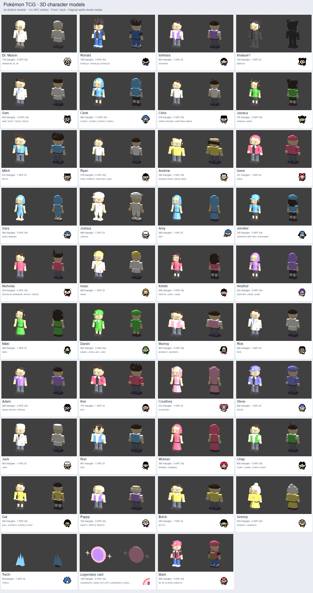

# Pokémon TCG character models

All 115 NPC entries from the sprite atlas are covered by **39 authored models**:
37 humans and two prop families. They provide 42 appearances without creating
duplicate models for NPC aliases or palette changes. Dr. Mason and Ronald retain
the approved designs and colors from the Lightning character demo.

Open [assets/cast.blend](assets/cast.blend) to inspect the unique cast together.
The [model index](MODELS.md) links every individual Blender source and its aliases.
Keep the `assets` directory structure intact: the cast links the individual
models, and those models link reusable meshes from `assets/parts.blend`.
Blender 5.2.1 and Fast64 2.6.0 were used. Enable Fast64 to edit/preview its
materials. The native assets and ROM do not require Blender or Fast64.



## What is shared

- **Whole models:** exact sprite duplicates are aliases in [bindings.json](bindings.json).
  For example, Sam, the technicians, Joseph, David, Erik and Aaron share the same
  sprite, so they share one technician model. Ronald's three IDs share one model.
- **Geometry:** 33 linked mesh pieces serve 801 authored part instances in the new
  characters. Heads, face surfaces, hands, ears, limb sections, shoes, torso
  shapes, coat/skirt shapes and suitable hair/cap pieces share mesh datablocks.
  Distinct body proportions, hair silhouettes, accessories and clothing panels
  remain explicit in [tools/designs.py](tools/designs.py).
  Near-coplanar face and clothing panels are baked with their owning head or
  torso into one exterior surface. The linked authoring pieces remain hidden
  in each editable model; only their material-preserving exterior is exported.
  Uncapped hair, ears and animated limbs retain normal solid intersections.
  Capped heads own the hair, crown, brim and attached badge in one closed
  exterior. Hidden scalp and head faces are removed. `tools/check_caps.py`
  verifies final native headwear faces have an inside and outside using winding
  numbers, with no exported hidden scalp vertices.
  [Cap validation](review/cap_validation.json) records this camera-independent
  exterior proof for all five capped families.
- **Materials:** facial styles reuse textures; the cast needs 11 textures, all
  32×32 RGBA16. Opaque facial backgrounds use the same RGBA16-safe pigment as
  each character's solid head, ears, neck and limbs. Eye whites, pupils, glasses
  and mouths retain their painted colors. Faces and solids receive the same
  native directional lighting; palette images use Non-Color input in Blender
  so its preview agrees with the solid Fast64 material. UVs, the coordinate
  system and five rigid animation groups match the existing libdragon renderer.
- **Palettes:** Matthew, Robert/Jonathan/Lad 2, and Amanda are material variants
  of the Mania, Boy and Swimmer families respectively. No second authored mesh
  or `.blend` file is created for them.
- **Poses/components:** Amy stands or lies down with the same geometry; Murray's
  fixed west-facing entry reuses his regular model. The six legendary-card NPC
  entries select pieces of one card-and-sparks assembly. The torch is a separate
  faceted 3D prop.

The native L643 format stores final positions and baked vertex colors. Standalone
exports therefore bake shared parts into each asset for the existing renderer;
they do not provide cross-model geometry-buffer sharing at runtime. Whole-NPC
aliases still resolve to the same asset, and textures remain shared. Palette,
pose and component binaries are derived exports, not additional authored models.

The duplicate audit uses ROM sprite-graphics hashes, animation palettes and
directionless flags, rather than character names. See [catalog.json](catalog.json)
and the [original sprite references](references/unique_sprites.png).

## Files and runtime bindings

Each `assets/models/<name>/` contains:

- `<name>.blend`: one editable canonical model, with linked reusable parts.
- `scene.l64` and `scene.json`: native indexed meshes, material/texture names,
  part pivots, provenance and appearance/pose metadata.
- `front.png` and `back.png`: actual Blender renders used for review.
- `variants/`, `poses/` or `components/` where that model needs derived exports.

Textures are stored once in `assets/textures/`. To load a standalone asset with
the Lightning demo renderer, copy its `scene.l64` into DragonFS and convert its
listed textures to RGBA16 sprites under `textures/`. Call `scene_draw_actor`
using its `runtime_model` ID. [bindings.json](bindings.json) resolves every NPC
constant to the correct asset, runtime ID, appearance, pose and optional heading.
Amy's binding selects the baked lying pose; Murray's fixed entry adds heading 270.

Parts 0–4 are body/head, left leg, right leg, left arm and right arm. Blender is
X east, Y north, Z up, facing -Y; native coordinates are X east, Y up, Z south,
facing +Z. Parts preserve the existing rigid walk-animation contract.

## Edit or regenerate

```sh
make model NAME=nikki   # rebuild only this unique family and validate it
make models            # process families sequentially in original atlas order
make test             # includes actual native skin-palette/shade checks
make test-blender     # checks linked face-image pixels and skin materials
make sheet
make cast
```

`make models` skips already verified, unchanged recipes. To force all models:

```sh
python3 tools/build_all.py --force
```

To rebuild the shared pieces use `make parts`; to redo the ROM duplicate audit
use `make catalog`. Regeneration replaces generated model files, so preserve
manual edits separately before rerunning their recipes.

To export a saved manual edit, open its `.blend` in Blender and run in the Python
console (replace `REPO` with this checkout):

```python
import sys
from pathlib import Path
sys.path.insert(0, 'REPO/port/frontends/n64/lightning-characters/tools')
import export_scene
export_scene.OUT = Path('OUTPUT_DIRECTORY')
export_scene.export_scene()
```

For a material or pose override in an opened canonical model:

```python
sys.path.insert(0, 'REPO/port/characters/tools')
import apply_variant
apply_variant.apply('swimmer_palette2')  # on the Swimmer model
# On Amy: apply_variant.apply(pose='lying')
```

This changes materials/transforms without copying mesh data. The helper also
updates pivots for export. After manual edits, regenerate native variant/pose
exports before rebuilding the gallery.

Native export validation also rejects duplicate and degenerate triangles across
all 49 exports. The exterior bake preserves facial-feature pixels, pigments,
all four limb meshes, UVs and joint pivots; it removes a duplicated torso in the
bodysuit recipe. [Exterior validation](review/exterior_validation.json) records
per-export counts and hashes.

When changing a skin material, run `skin.prepare_skin` before export to regenerate
its matching opaque facial background. It preserves facial-feature pixels and
uses a palette-specific texture name, so another character's skin tone is not
overwritten. Normal model builds do this automatically. The shared exporter only
lights textures explicitly marked `native_lit_texture`; room textures keep their
existing shading. [Before/after review](review/skin_consistency.png) compares four
characters, and `tools/check_skin.py` checks all native face vertices against the
solid-skin pigment and directional-light rule. The earlier skin-only pass is recorded in
[skin validation](review/skin_validation.json), including its geometry/UV/rig
hashes and historical 49-export native-gallery evidence.
[Exterior preservation](review/exterior_preservation.json) verifies that the
current bake retains all limb geometry, UVs, colors and pivots, plus every human
family’s pigment and facial-feature pixels.

## N64 viewer and verification

```sh
make gallery
open -a ares gallery/cast.z64
make capture
```

D-pad or C-left/right selects a model; stick X rotates it; hold B for the walk
pose; START resets rotation. The viewer includes each appearance and derived pose
or component once. It uses the existing Lightning libdragon loader and renderer.
The existing Lightning scenes are not populated with the entire cast.

Validation covers every NPC binding, triangle indices, finite geometry, UVs,
degenerate triangles, texture-memory limits, five-part rigs, palette geometry
identity and front/back renders. Humans use 518–906 triangles; the torch has 68
and the card assembly 128. Each texture occupies 2 KiB of the RDP's 4 KiB TMEM.

The original **49 native exports** were rendered in ares with **4 MiB RAM**, four headings
and a rigid walking pose each, with GL error assertions enabled. Historical
RDP framebuffer captures are in [review/n64](review/n64); the tested ROM hash and
complete verified-entry list are in [review/n64_validation.json](review/n64_validation.json).
These tests do not establish performance on physical hardware.
