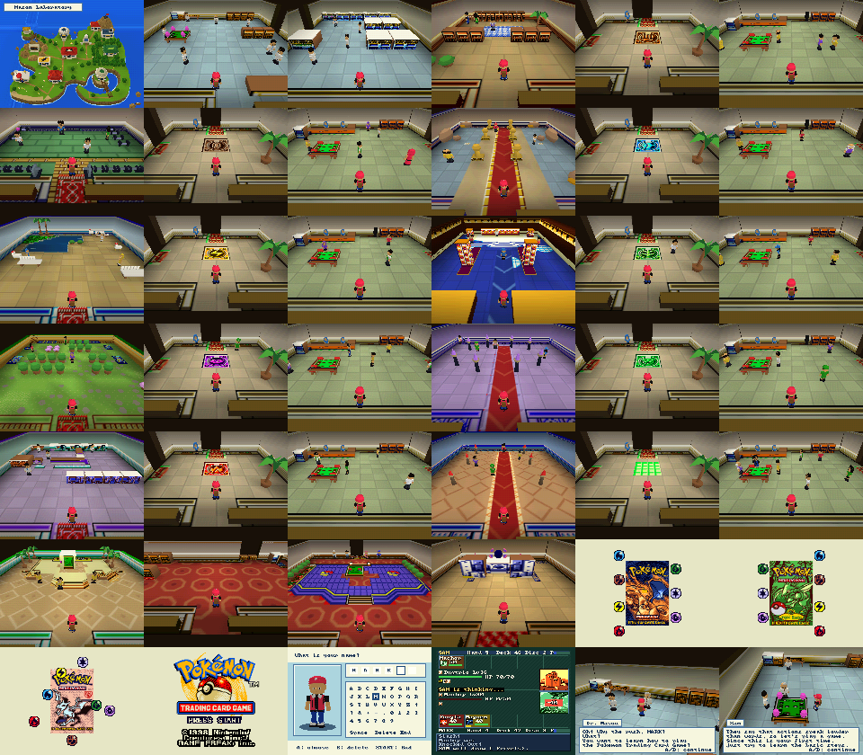

# Pokemon Trading Card Game — N64 adventure

The combined libdragon port: all 34 maps, native portable-C story and gameplay,
the existing duel engine/screen, two local diaries, and streamed original music
and sound effects. The island uses a nearly overhead 3D camera; interiors use
the third-person room view established by the Lightning prototype.



This gallery contains framebuffer pixels before VI video filtering. Use ares
Tools → Capture Screenshot to inspect the actual post-VI image.

## Build and play

```sh
make -C port/frontends/n64 N64_INST=/opt/libdragon
open -a ares port/frontends/n64/adventure/poketcg-adventure.z64
```

Requires libdragon **preview**, its MIPS toolchain, and asset tools. The ROM
declares **32 KiB cartridge SRAM** and runs with **4 MiB RDRAM**. The generated
scene/audio/gameplay assets are checked in; normal builds need neither Blender,
the original Game Boy ROM, RGBDS, nor libgme. `make duel` in the parent directory
still builds the separate duel-only frontend.

Builds first scan the character catalog and completed native character exports.
All 39 canonical characters now use their detailed models, including palette
variants, Amy's lying pose, and separate legendary-card components. Later exports
replace the matching models automatically; aliases share a model,
and only characters needed by the current map are loaded into RDRAM.

The original opening plays before the title: three booster scenes, moving
Energy symbols, fades, original music and effects, then the blinking PRESS
START prompt. A/START skips the opening to the title; press again at the prompt
to choose a diary. The opening repeats if the title is left unattended.

Choose Diary 1 or Diary 2. New-game naming shows Mark beside the keyboard.
Each diary has its own name, story, collection, decks,
recipes, mail, records, settings, and Card Pop identity. A new diary starts with
the original introduction, Sam's practice duel, and starter choice. Continue
reopens the saved game or resumes its saved single-player duel. Reset to choose
another diary. The title menu also offers Card Pop! between the two diaries.

| Control | Action |
| --- | --- |
| Stick / D-pad | Walk; choose island destination; navigate menus |
| A | Talk, inspect, enter, confirm; complete text / advance page |
| B | Back; hold while walking to move faster |
| START | Adventure menu; card details during a duel |
| L/R | Page through lists |
| Z | Check play areas during a duel |

The original island connections, room permissions, NPC preload conditions,
story movement, rewards, conditional doors, dialogue, win/loss branches, and
postgame progression drive the 3D frontend. Conversations and features use
native N64 menus; the Game Boy is not emulated at runtime. Story dialogue stays
in a four-line panel over the 3D scene. Scripted movement uses the original
60 Hz timing converted to 30 Hz, distance-based footsteps, and Mason/Sam
camera framing. On the island, the destination cursor and walking Mark are
separate, as in the source game.

## Video output

The renderer uses 320 × 240 RGBA16 with resample-only VI output. The additional
VI antialiasing/divot/dedither chain softened small landmark features and text;
resampling retains more detail while still scaling the native image. Landmark
footprints and their major roof/rune details are sized for this output.
Solid room and character meshes use ordinary opaque depth testing (`GL_LESS`);
the special interpenetrating mode is used only by the visual A/B diagnostic.
Contact shadows use a separate blended pass with depth writes disabled.

[Overworld before/after from ares](../../../reviews/overworld-readability/comparison.png)

[Full character and surface review](../../../reviews/surface-audit/index.html)

Ares screenshots from Tools → Capture Screenshot include VI processing, before
window shaders/scaling. At SD quality, its progressive 640 × 240 captures should
be displayed at a 4:3 aspect ratio. The diagnostic framebuffer PNGs are a
separate, sharper pre-VI reference.

To hold the production island for display comparisons:

```sh
make -C port/frontends/n64/adventure BUILD_DIR=build/vi-review \
  ROM=poketcg-vi-review DIAGNOSTIC=4 bundle
```

The diagnostic alternates the selected location between the laboratory and
Dome, leaving each roof unobstructed in one view.

`VI_FILTER=FILTERS_RESAMPLE_ANTIALIAS_DEDITHER` restores the earlier filter for
comparison. The build tracks the diagnostic/filter configuration and rebuilds
its frontend objects when either changes.

## Diaries and multiplayer

Adventure data uses two journal slots on SRAM. Each committed slot has version,
generation, header/table/payload CRCs; its header is written last. A failed or
interrupted save recovers the preceding complete slot. Card Pop and Gift Center
exchanges commit **both** diaries together, preventing mixed saves, duplication,
or lost gifts after an interrupted transaction.

This frontend checkpoints single-player duels before and after play, alongside
explicit Diary/script saves. That retains completed duels more eagerly than
the original game's separate manual-Diary backup. Settings save immediately.
The original story, rewards, and conditional progression remain in the portable
engine; the SRAM journal and checkpoint policy are N64 save adaptations.

- **Card Pop!** uses the original encoded six-character names, persistent random
  name salts, history, rarity selection, and RNG. Both diaries receive their
  own card and remember the exchange.
- **Gift Center** sends or receives free collection cards or saved deck recipes
  between the diaries. Sending removes physical cards only in the completed
  transaction; recipes are copied without creating or moving owned cards.
- **Battle Center** uses each diary's selected deck. Controller 1 controls the
  active diary and controller 2 the other diary; a second controller is required.
  Link duels are not resumable, matching the original game's link-duel behavior.
- **Print** provides card/deck/collection reports, an on-screen preview, and an
  optional fresh Controller Pak `.TXT` note. It never formats a Pak or deletes
  existing notes. This replaces Game Boy Printer transport on N64.

These are N64 adaptations of the original infrared/link/printer features;
they do not communicate with Game Boys or a physical Game Boy Printer.

## Engines and assets

- [Story engine](../../../overworld/README.md): all 104 story opcodes and 940
  verified native source operations, map scripts/objects/warps/preloads,
  canonical saves, and pending-duel continuation.
- [Gameplay](../../../gameplay/gameplay.h): collection/album rules, four built
  decks, 60 saved recipes, all 50 Auto Deck Machine recipes, all 29 boosters,
  mail, Challenge Machine, Card Pop, and gift transactions.
- [3D assets](../../../world3d/README.md): all rooms, shared lobby/entrance
  shells, reusable prop meshes, independent printer states, and editable
  `all_maps.blend`. The approved Lightning geometry is preserved.
- [Audio](../../../audio/README.md): all 31 music and 96 SFX IDs, rendered
  offline from the original driver into about 30 MiB of streamed WAV64 audio.
- [Source audit](../../../notes/OVERWORLD_AUDIT.md): source inventory,
  fidelity requirements, validation boundaries, and corrected defects.

No duel-engine modules are dropped from the adventure build. The existing duel
screen is reused through `duel_bridge.h`; its callbacks save single-player
duels and return the result and RNG to the story engine.

## Verification

```sh
make -C port/frontends/n64/adventure test
make -C port/gameplay differential
make -C port/frontends/n64/adventure validate
make -C port/frontends/n64/adventure video-diagnostic
make -C port/frontends/n64/adventure visual-diagnostic
python3 port/frontends/n64/adventure/tools/validate_visual.py \
  port/frontends/n64/adventure/poketcg-visual.z64
```

`DIAGNOSTIC=5` draws every imported character and all six fallbacks in four
views (front, back, side and maximum walking swing), followed by every map
and the naming portrait. It also compares interpenetrating and normal opaque
depth testing on identical Mark, Mason and Tech assets. These are review-only
labels and cameras; production framing and gameplay remain unchanged. The
validator records all native framebuffer hashes separately from post-VI exports.
`DIAGNOSTIC=6` is the shorter held post-VI sequence: the same three character
A/B pairs plus the island, laboratory, Water, Lightning and Dome scenes.
`DIAGNOSTIC=7` holds Mark and the Lightning/Dome follow cameras for a short
headwear regression check through actual VI output.

The host checks cover gameplay, native helpers, script branches, navigation,
UI feature behavior, two-diary exchanges, and interrupted SRAM writes. Original
ROM differential checks compare booster contents/final RNG, Challenge Machine
opponent selection, and Card Pop results.

The diagnostic ROM runs in ares/paraLLEl-RDP with 4 MiB RAM and retains the real
duel/story code for a representative memory budget. It checks:

- Every map loaded/rendered, with 34 native framebuffer captures and heap stats.
- The campaign from new game through all medals, Grand Masters, Ronald, four
  legendary cards, credits, and postgame Challenge Cup on big-endian MIPS. This
  story fixture supplies duel outcomes while using real scripts and inventory.
- 714 NPC milestone/win-loss cases, all 144 island paths, real door patches and
  warps, and canonical save bytes.
- An actual automated AI duel through the existing duel engine, native screen,
  card art, and audio.
- Four original opening/title frames and source animation/fade invariants,
  plus Mark's naming screen and the actual source introduction at Mason and
  Sam's table, bringing the native captures to 42.
- Both diaries written to actual emulated cartridge SRAM, RAM state discarded,
  and diaries reloaded and checked.

The saved [native validation record](../../../world3d/generated/native/validation.json)
records ROM identity, every framebuffer hash, and measured heap use. The tested
diagnostic retained **1,006,096 bytes** of free heap in its busiest room.

Physical-console performance and a complete human playthrough remain unverified.
Rooms retain simplified geometry. Sampled music and SFX
retain their original standalone sequences, but overlapping effects do not
reproduce the Game Boy's exact per-voice channel stealing. Controller Pak report
I/O is covered by host mocks; physical Pak hardware remains untested.

Text and duel screens draw into a cached offscreen canvas. RDP copies only
the completed canvas into the reserved display buffer, then a completion fence
precedes presentation. The map label and story panels use the same fenced
compositing path. This keeps CPU drawing out of the display framebuffer chain.
VI antialiasing now receives valid RDP coverage for both 3D and UI frames.
ares v148 does not update that hidden coverage on CPU framebuffer writes;
copying complete UI frames through RDP avoids the corrupt final-video AA
state while retaining antialiasing for rooms and terrain.
`poketcg-video.z64` holds and repeats room, dialogue, duel, and card phases;
each UI phase checks 90 identical frames across all three buffers. Its actual
video output also needs visual inspection because the saved native captures
are taken before VI processing.

After replacing a ROM, close and reopen it to load the new executable. An old
emulator save state also restores the old code; use the cartridge diary save
to continue with an updated build.
