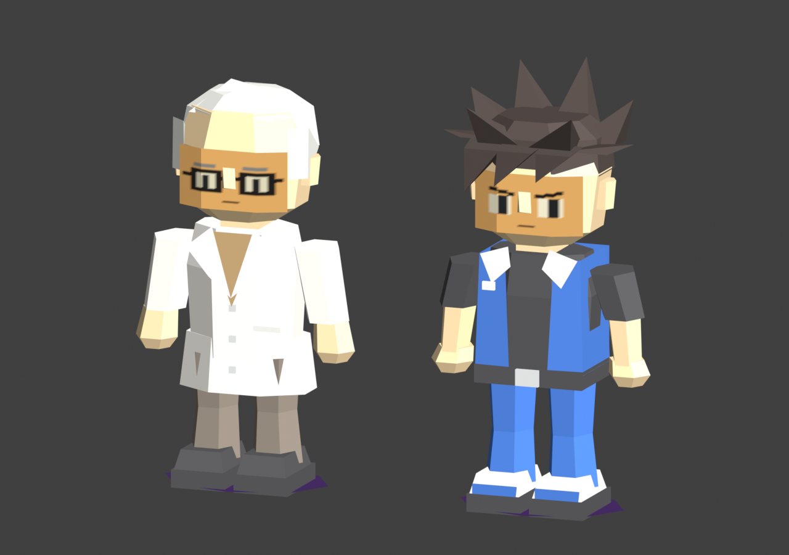
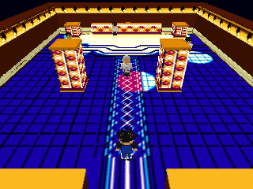

# Dr. Mason and Ronald — Lightning Club test

A separate copy of the Lightning Club demo with Ronald as the playable character
and Dr. Mason replacing Jennifer at (14,18). The room, Isaac, Nicholas and Brandon
are unchanged. Controls: stick/D-pad to walk, B to run, START to reset,
C-left/right to pan.

## Run

```sh
make -j4 N64_INST=/opt/libdragon
open -a ares lightning-characters.z64
```

The generated meshes and textures are included; building the ROM needs no Blender.
Uses the same libdragon preview OpenGL pipeline as the original Lightning demo.

## Editable models

| Character | Blender source | Triangles | Rigid parts | Face texture |
|---|---|---:|---:|---|
| Dr. Mason | [dr_mason.blend](assets/models/dr_mason/dr_mason.blend) | 577 | 5 | 32×32 RGBA16 |
| Ronald | [ronald.blend](assets/models/ronald/ronald.blend) | 640 | 5 | 32×32 RGBA16 |

Both were modeled in Blender from [the generated concept](assets/concept.png),
using Fast64 F3D materials in Homebrew mode. The clothing, hair, ears, noses,
hands and shoes are polygon geometry; eyes, eyebrows, glasses and mouths use
painted textures. Flat surfaces, small textures and rigid limbs suit the N64.

The [combined scene](assets/lightning_characters.blend) has placed instances and
hidden local-origin export sources. Edit the source meshes in Edit Mode; preview
instances share the mesh data. Each source has `model`, `part`, `pivot` and
`export_source` custom properties. Part 0 is body/head, 1/2 legs, 3/4 arms.
Blender coordinates are X east, Y north, Z up; local forward is -Y. The exporter
converts to runtime X east, Y up, Z south, with local forward +Z.

[Side-by-side Blender preview](assets/characters-preview.png):



## Export and reuse

```sh
make export  # export saved scene edits plus both standalone model files
make test
make -j4
```

Each `assets/models/<character>/` contains an editable packed-texture `.blend`,
`scene.l64`, `scene.json`, a preview and `textures/`. The standalone native L643
mesh uses exactly the same vertex/index/UV/rig data as the combined room, with
texture indices compacted. It can be loaded with this demo's `scene.c` loader
instead of the room asset: copy its `scene.l64` and texture sprites into DragonFS,
then call `scene_draw_actor(1,...)` for Ronald or `(4,...)` for Mason. These are
native assets for this libdragon renderer, not Nintendo SDK display lists.

The original `scene.c` batches all solid materials into baked vertex colors;
Fast64 materials are used for Blender authoring/preview. No new microcode or
renderer dependency is needed. The full scene has 2,347 triangles, 4,522 exported
vertices, 57 batches and 36 textures, all individually within 4 KiB TMEM.

## Regenerate

`make assets` rebuilds both characters from `tools/build_characters.py`, reads the
original sibling Lightning `.blend` without writing it, and overwrites this copy's
generated models, exports and previews. It uses Blender 5.2.1 LTS and
[Fast64](https://github.com/Fast-64/fast64) 2.6.0, revision
`566d57b2ec38a968a04dab4bd7ea32ac4e91d55d`. Fast64 is installed in this machine's
Blender 5.2 add-ons directory. On another machine install/enable that add-on and
set `BLENDER` to the Blender executable. Fast64's documented support currently
ends at 5.1.2; this workflow was exercised successfully on 5.2.1.

## Validation

`make test` checks the binary meshes, texture budgets, exact placement, all five
rigid joints, standalone/scene equality, original room/other NPC equality and
native movement/collision tests.

`make capture` builds a diagnostic ROM and runs ares with 4 MiB RAM. Seven actual
320×240 RDP framebuffers are saved in `assets/n64-*.png`: entrance, walking,
NPC collision, Mason front, Ronald front, both backs and a walking pose. The
emulated program asserts setup/frame GL errors and center-aisle collision. The
ROM hash and capture settings are in `build/capture/result.json`.



Built and captured successfully in ares with paraLLEl-RDP. Physical N64 hardware
and its performance have not been tested. This is a walking/model test; it adds
no NPC dialogue, duels or gameplay beyond the original room prototype.
