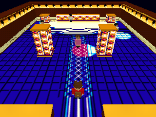

# Lightning Club prototype

A standalone, playable Nintendo 64 room using libdragon preview's OpenGL/RSP
pipeline and RDP texturing. Builds separately from the duel frontend.



## Build and run

From this directory:

```sh
make -j4 N64_INST=/opt/libdragon
open -a ares lightning.z64
```

Requires the N64 toolchain, libdragon **preview** (OpenGL), and its asset tools.
The checked-in binary meshes and PNG textures let you build without Blender or
the original ROM. `N64_INST` defaults to `/opt/libdragon` on this machine.

Controls: stick or D-pad to walk; hold B to run; START to return to the entrance;
C-left/right to pan the fixed camera. The room starts immediately, without a HUD.

## Models and editing

- `assets/lightning_club.blend`: editable room, UVs, packed textures, four
  reusable character models, five placed character instances, and camera.
- `assets/scene.l64`: big-endian indexed meshes consumed by the N64 renderer.
- `assets/textures/`: small PNG textures extracted from the original map.
- `assets/scene.json`: mesh counts, texture names, placements, collision boxes,
  and camera settings.

Open the Blender file and edit room meshes or the character meshes shared by
the placed preview instances. The hidden **Character models (local origin)**
collection holds the export sources; the visible instances share their mesh
data. Edit mesh vertices in Edit Mode to update the shared model. Runtime limb
animation uses the exported `part` and `pivot` custom properties: body 0,
left/right legs 1/2, left/right arms 3/4. There is no external add-on dependency.

To export the edited file and rebuild:

```sh
make export
make test
make -j4
```

`make export` reads the saved Blender file, applies mesh modifiers, triangulates,
bakes flat vertex colors, groups by material and rigid joint, and exports indices
and UVs. It exports only meshes tagged `export_source`; preview instances are
excluded. Existing material texture IDs refer to `assets/textures/`.

`make assets` **regenerates** the Blender file and assets from `tools/build_scene.py`
and `port/maps/lightning_club.png`, replacing manual model edits. Set `BLENDER`
to the executable path on another machine. Blender is only needed for export
or regeneration. The generator was tested with Blender 5.2.1.

Blender uses X east, Y north, Z up. The exporter converts to X east, Y up,
Z south. Map positions remain Isaac (12,4), Nicholas (6,10), Brandon (22,12),
Jennifer (14,18); Mark starts at (14,28), facing north. NPC start directions
match `src/data/npc_map_data.asm`.

The map's long pillar silhouettes encode elevation. Their solid feet are 2x2
units, placed on either side of the aisle. The bolt, circles, and magenta burst
are walkable floor textures. The shrine, pillars, walls, and NPCs stop movement.

## Renderer

`scene.c` loads retained vertex/index arrays and RGBA16 sprites from DragonFS,
then compiles indexed draw calls into OpenGL display lists. The room is a static
list; characters use body and limb lists with rigid joint transforms. Nicholas
and Brandon reuse one model. Textures are at most 2 KiB each, within the RDP's
4 KiB TMEM; the floor is split into deduplicated 32x32 chunks. Baked vertex
lighting and opaque contact shadows avoid runtime lights and transparency.

320x240, RGBA16, triple buffering, depth buffer, RDP antialiasing, three-point
texture filtering, and VI resampling. A 30 FPS limit is requested; physical N64
performance has not been measured. The scene contains 1,716 triangles and 3,302
exported vertices in 55 batches, using 34 textures. Runtime movement uses
substepped circle collision and independent axis sliding.

## Validation

```sh
make test       # binary mesh/TMEM/placement checks and native collision tests
make capture    # diagnostic ROM, ares, three actual RDP framebuffer captures
```

`make capture` uses isolated emulator settings and **4 MiB RAM**, records the
diagnostic ROM hash in `build/capture/result.json`, and saves `assets/n64-*.png`.
It verifies setup/render GL errors, walks the player north, checks the NPC
collision in the emulated MIPS program, and reads pixels only after an RDP fence.
These captures precede VI filtering. `assets/blender-preview.png` is a Blender
render, separate from the N64 captures.

Tested by building the ROM and running all three capture scenes in ares v148
with paraLLEl-RDP. Not tested on a physical console. NPC dialogue, duels, audio,
room transitions, and saving are outside this room prototype.

API references: [libdragon preview](https://github.com/DragonMinded/libdragon/wiki/Preview-branch),
[OpenGL on N64](https://github.com/DragonMinded/libdragon/wiki/OpenGL-on-N64).
