# Pokémon Trading Card Game (GBC) map renders

Rendered from the original ROM data (`poketcg.gbc` + `poketcg.sym`) by
[`port/tools/render_maps.py`](../tools/render_maps.py). Every image is at native
resolution: one map tile = 8x8 pixels, no scaling. Rerun with
`python3 port/tools/render_maps.py` (add `--check` to cross-check the decoded
tilemaps and tilesets against the disassembly's uncompressed files).

## Maps

One image per entry of the map list (`constants/map_constants.asm`); every one
of them is reachable (`data/warps.asm`, `data/overworld_map/overworld_warps.asm`).

| Map constant | Name | Image | Size (tiles) | Tilemap / tileset / palette |
|---|---|---|---|---|
| `OVERWORLD_MAP` | Overworld map (TCG Island) | [overworld.png](overworld.png) | 20x18 | `TILEMAP_OVERWORLD_MAP_CGB` / `TILESET_OVERWORLD_MAP` / `PALETTE_OVERWORLD_MAP` |
| `MASON_LABORATORY` | Mason Laboratory (Dr. Mason's lab, main room) | [mason_laboratory.png](mason_laboratory.png) | 28x30 | `TILEMAP_MASON_LABORATORY_CGB` / `TILESET_MASON_LABORATORY` / `PALETTE_MASON_LABORATORY` |
| `DECK_MACHINE_ROOM` | Mason Laboratory: Deck Machine room | [deck_machine_room.png](deck_machine_room.png) | 24x30 | `TILEMAP_DECK_MACHINE_ROOM_CGB` / `TILESET_MASON_LABORATORY` / `PALETTE_MASON_LABORATORY` |
| `ISHIHARAS_HOUSE` | Ishihara's House | [ishiharas_house.png](ishiharas_house.png) | 20x24 | `TILEMAP_ISHIHARA_CGB` / `TILESET_ISHIHARA` / `PALETTE_ISHIHARAS_HOUSE` |
| `FIGHTING_CLUB_ENTRANCE` | Fighting Club: entrance | [fighting_club_entrance.png](fighting_club_entrance.png) | 20x18 | `TILEMAP_FIGHTING_CLUB_ENTRANCE_CGB` / `TILESET_CLUB_ENTRANCE` / `PALETTE_FIGHTING_CLUB_ENTRANCE` |
| `FIGHTING_CLUB_LOBBY` | Fighting Club: lobby | [fighting_club_lobby.png](fighting_club_lobby.png) | 28x26 | `TILEMAP_CLUB_LOBBY_CGB` / `TILESET_CLUB_LOBBY` / `PALETTE_CLUB_LOBBY` |
| `FIGHTING_CLUB` | Fighting Club: club room | [fighting_club.png](fighting_club.png) | 24x18 | `TILEMAP_FIGHTING_CLUB_CGB` / `TILESET_FIGHTING_CLUB` / `PALETTE_FIGHTING_CLUB` |
| `ROCK_CLUB_ENTRANCE` | Rock Club: entrance | [rock_club_entrance.png](rock_club_entrance.png) | 20x18 | `TILEMAP_ROCK_CLUB_ENTRANCE_CGB` / `TILESET_CLUB_ENTRANCE` / `PALETTE_ROCK_CLUB_ENTRANCE` |
| `ROCK_CLUB_LOBBY` | Rock Club: lobby | [rock_club_lobby.png](rock_club_lobby.png) | 28x26 | `TILEMAP_CLUB_LOBBY_CGB` / `TILESET_CLUB_LOBBY` / `PALETTE_CLUB_LOBBY` |
| `ROCK_CLUB` | Rock Club: club room | [rock_club.png](rock_club.png) | 28x30 | `TILEMAP_ROCK_CLUB_CGB` / `TILESET_ROCK_CLUB` / `PALETTE_ROCK_CLUB` |
| `WATER_CLUB_ENTRANCE` | Water Club: entrance | [water_club_entrance.png](water_club_entrance.png) | 20x18 | `TILEMAP_WATER_CLUB_ENTRANCE_CGB` / `TILESET_CLUB_ENTRANCE` / `PALETTE_WATER_CLUB_ENTRANCE` |
| `WATER_CLUB_LOBBY` | Water Club: lobby | [water_club_lobby.png](water_club_lobby.png) | 28x26 | `TILEMAP_CLUB_LOBBY_CGB` / `TILESET_CLUB_LOBBY` / `PALETTE_CLUB_LOBBY` |
| `WATER_CLUB` | Water Club: club room | [water_club.png](water_club.png) | 28x32 | `TILEMAP_WATER_CLUB_CGB` / `TILESET_WATER_CLUB` / `PALETTE_WATER_CLUB` |
| `LIGHTNING_CLUB_ENTRANCE` | Lightning Club: entrance | [lightning_club_entrance.png](lightning_club_entrance.png) | 20x18 | `TILEMAP_LIGHTNING_CLUB_ENTRANCE_CGB` / `TILESET_CLUB_ENTRANCE` / `PALETTE_LIGHTNING_CLUB_ENTRANCE` |
| `LIGHTNING_CLUB_LOBBY` | Lightning Club: lobby | [lightning_club_lobby.png](lightning_club_lobby.png) | 28x26 | `TILEMAP_CLUB_LOBBY_CGB` / `TILESET_CLUB_LOBBY` / `PALETTE_CLUB_LOBBY` |
| `LIGHTNING_CLUB` | Lightning Club: club room | [lightning_club.png](lightning_club.png) | 28x32 | `TILEMAP_LIGHTNING_CLUB_CGB` / `TILESET_LIGHTNING_CLUB` / `PALETTE_LIGHTNING_CLUB` |
| `GRASS_CLUB_ENTRANCE` | Grass Club: entrance | [grass_club_entrance.png](grass_club_entrance.png) | 20x18 | `TILEMAP_GRASS_CLUB_ENTRANCE_CGB` / `TILESET_CLUB_ENTRANCE` / `PALETTE_GRASS_CLUB_ENTRANCE` |
| `GRASS_CLUB_LOBBY` | Grass Club: lobby | [grass_club_lobby.png](grass_club_lobby.png) | 28x26 | `TILEMAP_CLUB_LOBBY_CGB` / `TILESET_CLUB_LOBBY` / `PALETTE_CLUB_LOBBY` |
| `GRASS_CLUB` | Grass Club: club room | [grass_club.png](grass_club.png) | 28x32 | `TILEMAP_GRASS_CLUB_CGB` / `TILESET_GRASS_CLUB` / `PALETTE_GRASS_CLUB` |
| `PSYCHIC_CLUB_ENTRANCE` | Psychic Club: entrance | [psychic_club_entrance.png](psychic_club_entrance.png) | 20x18 | `TILEMAP_PSYCHIC_CLUB_ENTRANCE_CGB` / `TILESET_CLUB_ENTRANCE` / `PALETTE_PSYCHIC_CLUB_ENTRANCE` |
| `PSYCHIC_CLUB_LOBBY` | Psychic Club: lobby | [psychic_club_lobby.png](psychic_club_lobby.png) | 28x26 | `TILEMAP_CLUB_LOBBY_CGB` / `TILESET_CLUB_LOBBY` / `PALETTE_CLUB_LOBBY` |
| `PSYCHIC_CLUB` | Psychic Club: club room | [psychic_club.png](psychic_club.png) | 28x28 | `TILEMAP_PSYCHIC_CLUB_CGB` / `TILESET_PSYCHIC_CLUB` / `PALETTE_PSYCHIC_CLUB` |
| `SCIENCE_CLUB_ENTRANCE` | Science Club: entrance | [science_club_entrance.png](science_club_entrance.png) | 20x18 | `TILEMAP_SCIENCE_CLUB_ENTRANCE_CGB` / `TILESET_CLUB_ENTRANCE` / `PALETTE_SCIENCE_CLUB_ENTRANCE` |
| `SCIENCE_CLUB_LOBBY` | Science Club: lobby | [science_club_lobby.png](science_club_lobby.png) | 28x26 | `TILEMAP_CLUB_LOBBY_CGB` / `TILESET_CLUB_LOBBY` / `PALETTE_CLUB_LOBBY` |
| `SCIENCE_CLUB` | Science Club: club room | [science_club.png](science_club.png) | 28x32 | `TILEMAP_SCIENCE_CLUB_CGB` / `TILESET_SCIENCE_CLUB` / `PALETTE_SCIENCE_CLUB` |
| `FIRE_CLUB_ENTRANCE` | Fire Club: entrance | [fire_club_entrance.png](fire_club_entrance.png) | 20x18 | `TILEMAP_FIRE_CLUB_ENTRANCE_CGB` / `TILESET_CLUB_ENTRANCE` / `PALETTE_FIRE_CLUB_ENTRANCE` |
| `FIRE_CLUB_LOBBY` | Fire Club: lobby | [fire_club_lobby.png](fire_club_lobby.png) | 28x26 | `TILEMAP_CLUB_LOBBY_CGB` / `TILESET_CLUB_LOBBY` / `PALETTE_CLUB_LOBBY` |
| `FIRE_CLUB` | Fire Club: club room | [fire_club.png](fire_club.png) | 28x32 | `TILEMAP_FIRE_CLUB_CGB` / `TILESET_FIRE_CLUB` / `PALETTE_FIRE_CLUB` |
| `CHALLENGE_HALL_ENTRANCE` | Challenge Hall: entrance | [challenge_hall_entrance.png](challenge_hall_entrance.png) | 20x18 | `TILEMAP_CHALLENGE_HALL_ENTRANCE_CGB` / `TILESET_CLUB_ENTRANCE` / `PALETTE_FIGHTING_CLUB_ENTRANCE` |
| `CHALLENGE_HALL_LOBBY` | Challenge Hall: lobby | [challenge_hall_lobby.png](challenge_hall_lobby.png) | 28x26 | `TILEMAP_CLUB_LOBBY_CGB` / `TILESET_CLUB_LOBBY` / `PALETTE_CLUB_LOBBY` |
| `CHALLENGE_HALL` | Challenge Hall: hall (Challenge Cup) | [challenge_hall.png](challenge_hall.png) | 32x32 | `TILEMAP_CHALLENGE_HALL_CGB` / `TILESET_CHALLENGE_HALL` / `PALETTE_CHALLENGE_HALL` |
| `POKEMON_DOME_ENTRANCE` | Pokémon Dome: entrance | [pokemon_dome_entrance.png](pokemon_dome_entrance.png) | 32x18 | `TILEMAP_POKEMON_DOME_ENTRANCE_CGB` / `TILESET_POKEMON_DOME_ENTRANCE` / `PALETTE_POKEMON_DOME_ENTRANCE` |
| `POKEMON_DOME` | Pokémon Dome: Grand Masters hall | [pokemon_dome.png](pokemon_dome.png) | 32x32 | `TILEMAP_POKEMON_DOME_CGB` / `TILESET_POKEMON_DOME` / `PALETTE_POKEMON_DOME` |
| `HALL_OF_HONOR` | Pokémon Dome: Hall of Honor | [hall_of_honor.png](hall_of_honor.png) | 24x26 | `TILEMAP_HALL_OF_HONOR_CGB` / `TILESET_HALL_OF_HONOR` / `PALETTE_HALL_OF_HONOR` |

Notes:

* **Overworld.** The overworld (`OVERWORLD_MAP`) is not a scrolling map in this
  game: it is a single-screen map of the island (20x18 tiles = 160x144 px) on which
  the player picks a destination, so `overworld.png` is the whole of it. In game the
  name of the selected place is printed in the empty box at the top left
  (`OverworldMap_PrintMapName`), the player sprite walks along the paths and smoke
  rises from the volcano. The text and the player are not drawn; the volcano smoke
  (an OBJ sprite) is drawn in
  [npcs/overworld_volcano_smoke.png](npcs/overworld_volcano_smoke.png).
* **Club lobbies.** All eight club lobbies and the Challenge Hall lobby use the same
  tilemap (`TILEMAP_CLUB_LOBBY_CGB`) and palette (`PALETTE_CLUB_LOBBY`), so their
  background images are identical; they differ only by NPCs (see below). The
  **Card Pop! / Gift Center** is not a separate map: it is the counter at the top of
  every lobby (`NPC_CLERK10` and `NPC_GIFT_CENTER_CLERK` stand behind it).
* The Challenge Hall entrance uses the Fighting Club entrance palette
  (`PALETTE_FIGHTING_CLUB_ENTRANCE`), as in `data/map_headers.asm`.
* `OWMAP_MYSTERY_HOUSE` is only a name ("Mystery House") the overworld shows for
  Ishihara's House before you have heard of it; it is the same map.

## Map event variants

Some maps have tile patches that the game applies when an event flag is set
(`SetOWMapEvent_SRAMOrVRAM` in `engine/overworld/map_events.asm`, applied from
each map's close-text-box script). The base images above show the maps with no
event applied; these show them with the patch:

| Map | Variant | Image |
|---|---|---|
| `MASON_LABORATORY` | Challenge Machine installed (MAP_EVENT_CHALLENGE_MACHINE, after receiving the legendary cards) | [events/mason_laboratory_challenge_machine.png](events/mason_laboratory_challenge_machine.png) |
| `DECK_MACHINE_ROOM` | all eight club Deck Machines switched on (MAP_EVENT_*_DECK_MACHINE, one per medal) | [events/deck_machine_room_all_deck_machines.png](events/deck_machine_room_all_deck_machines.png) |
| `POKEMON_DOME_ENTRANCE` | Pokémon Dome door open (MAP_EVENT_POKEMON_DOME_DOOR) | [events/pokemon_dome_entrance_door_open.png](events/pokemon_dome_entrance_door_open.png) |
| `POKEMON_DOME` | Hall of Honor door open (MAP_EVENT_HALL_OF_HONOR_DOOR) | [events/pokemon_dome_hall_of_honor_door_open.png](events/pokemon_dome_hall_of_honor_door_open.png) |

## NPCs

`npcs/` holds the same backgrounds with the NPCs drawn at their start positions
(`data/npc_map_data.asm`), facing their start direction, using the first frame of
their CGB sprite animation and the overworld OBJ palettes (`PALETTE_OVERWORLD_OAM`).
Every NPC of the map's list that starts on the map is drawn, **including the ones
whose pre-load function only loads them in some story states** (marked *cond.*
below), so an image can show NPCs that never appear together (e.g. Ronald, Imakuni,
the Challenge Hall crowd, the Grand Masters). Scripted NPCs are drawn where their
entry puts them even when a script walks them in from there (Ronald in
`POKEMON_DOME` starts inside the top-right wall). The player is not drawn.

| Map | Image | NPCs drawn (tile x,y) | Not drawn |
|---|---|---|---|
| `OVERWORLD_MAP` | [npcs/overworld_volcano_smoke.png](npcs/overworld_volcano_smoke.png) | `volcano smoke (SPRITE_OW_MAP_OAM, SPRITE_ANIM_CGB_VOLCANO_SMOKE)` (15,0) | - |
| `MASON_LABORATORY` | [npcs/mason_laboratory_npcs.png](npcs/mason_laboratory_npcs.png) | `NPC_DRMASON` (14,6) *cond.*, `NPC_SAM` (4,14) *cond.*, `NPC_TECH1` (22,8), `NPC_TECH2` (22,20), `NPC_TECH3` (22,22), `NPC_TECH4` (10,22), `NPC_TECH5` (6,4) *cond.* | - |
| `DECK_MACHINE_ROOM` | [npcs/deck_machine_room_npcs.png](npcs/deck_machine_room_npcs.png) | `NPC_TECH6` (6,8), `NPC_TECH7` (6,22), `NPC_TECH8` (10,18), `NPC_AARON` (12,12) | - |
| `ISHIHARAS_HOUSE` | [npcs/ishiharas_house_npcs.png](npcs/ishiharas_house_npcs.png) | `NPC_NIKKI` (4,4) *cond.*, `NPC_ISHIHARA` (8,8) *cond.*, `NPC_RONALD1` (2,4) *cond.* | - |
| `FIGHTING_CLUB_ENTRANCE` | [npcs/fighting_club_entrance_npcs.png](npcs/fighting_club_entrance_npcs.png) | `NPC_CLERK1` (6,2) | `NPC_RONALD1`: starts outside the map, at (8,-2), `NPC_RONALD2`: starts outside the map, at (-2,8), `NPC_RONALD3`: starts outside the map, at (-2,8) |
| `FIGHTING_CLUB_LOBBY` | [npcs/fighting_club_lobby_npcs.png](npcs/fighting_club_lobby_npcs.png) | `NPC_MAN1` (12,14), `NPC_IMAKUNI` (18,2) *cond.*, `NPC_SPECS1` (18,16), `NPC_BUTCH` (20,16), `NPC_GRANNY1` (4,16) *cond.*, `NPC_CLERK10` (6,4), `NPC_GIFT_CENTER_CLERK` (10,4) *cond.* | - |
| `FIGHTING_CLUB` | [npcs/fighting_club_npcs.png](npcs/fighting_club_npcs.png) | `NPC_CHRIS` (4,8) *cond.*, `NPC_MICHAEL` (14,10) *cond.*, `NPC_JESSICA` (18,6) *cond.*, `NPC_MITCH` (10,4) | - |
| `ROCK_CLUB_ENTRANCE` | [npcs/rock_club_entrance_npcs.png](npcs/rock_club_entrance_npcs.png) | `NPC_CLERK2` (6,2) | `NPC_RONALD1`: starts outside the map, at (8,-2), `NPC_RONALD2`: starts outside the map, at (-2,8), `NPC_RONALD3`: starts outside the map, at (-2,8) |
| `ROCK_CLUB_LOBBY` | [npcs/rock_club_lobby_npcs.png](npcs/rock_club_lobby_npcs.png) | `NPC_CHRIS` (18,8) *cond.*, `NPC_MATTHEW` (6,14), `NPC_WOMAN1` (20,18), `NPC_CHAP1` (14,16), `NPC_LASS3` (16,4) *cond.*, `NPC_CLERK10` (6,4), `NPC_GIFT_CENTER_CLERK` (10,4) *cond.* | - |
| `ROCK_CLUB` | [npcs/rock_club_npcs.png](npcs/rock_club_npcs.png) | `NPC_RYAN` (20,14), `NPC_ANDREW` (6,20), `NPC_GENE` (12,6) | - |
| `WATER_CLUB_ENTRANCE` | [npcs/water_club_entrance_npcs.png](npcs/water_club_entrance_npcs.png) | `NPC_CLERK3` (6,2) | `NPC_RONALD1`: starts outside the map, at (8,-2), `NPC_RONALD2`: starts outside the map, at (-2,8), `NPC_RONALD3`: starts outside the map, at (-2,8) |
| `WATER_CLUB_LOBBY` | [npcs/water_club_lobby_npcs.png](npcs/water_club_lobby_npcs.png) | `NPC_GAL1` (6,14), `NPC_LASS1` (16,10), `NPC_IMAKUNI` (18,2) *cond.*, `NPC_MAN2` (4,18) *cond.*, `NPC_PAPPY2` (22,16), `NPC_CLERK10` (6,4), `NPC_GIFT_CENTER_CLERK` (10,4) *cond.* | - |
| `WATER_CLUB` | [npcs/water_club_npcs.png](npcs/water_club_npcs.png) | `NPC_SARA` (6,18), `NPC_AMANDA` (22,20), `NPC_JOSHUA` (22,8), `NPC_AMY` (22,4) *cond.* | - |
| `LIGHTNING_CLUB_ENTRANCE` | [npcs/lightning_club_entrance_npcs.png](npcs/lightning_club_entrance_npcs.png) | `NPC_CLERK4` (6,2) | `NPC_RONALD1`: starts outside the map, at (8,-2), `NPC_RONALD2`: starts outside the map, at (-2,8), `NPC_RONALD3`: starts outside the map, at (-2,8) |
| `LIGHTNING_CLUB_LOBBY` | [npcs/lightning_club_lobby_npcs.png](npcs/lightning_club_lobby_npcs.png) | `NPC_CHAP2` (18,16), `NPC_IMAKUNI` (18,2) *cond.*, `NPC_LASS4` (8,12), `NPC_HOOD1` (20,8), `NPC_CLERK10` (6,4), `NPC_GIFT_CENTER_CLERK` (10,4) *cond.* | - |
| `LIGHTNING_CLUB` | [npcs/lightning_club_npcs.png](npcs/lightning_club_npcs.png) | `NPC_JENNIFER` (14,18), `NPC_NICHOLAS` (6,10), `NPC_BRANDON` (22,12), `NPC_ISAAC` (12,4) *cond.* | - |
| `GRASS_CLUB_ENTRANCE` | [npcs/grass_club_entrance_npcs.png](npcs/grass_club_entrance_npcs.png) | `NPC_CLERK5` (6,2), `NPC_MICHAEL` (14,8) *cond.* | `NPC_RONALD1`: starts outside the map, at (8,-2), `NPC_RONALD2`: starts outside the map, at (-2,8), `NPC_RONALD3`: starts outside the map, at (-2,8) |
| `GRASS_CLUB_LOBBY` | [npcs/grass_club_lobby_npcs.png](npcs/grass_club_lobby_npcs.png) | `NPC_BRITTANY` (12,14), `NPC_LASS2` (18,8), `NPC_GRANNY2` (4,16), `NPC_GAL2` (20,16) *cond.*, `NPC_CLERK10` (6,4), `NPC_GIFT_CENTER_CLERK` (10,4) *cond.* | - |
| `GRASS_CLUB` | [npcs/grass_club_npcs.png](npcs/grass_club_npcs.png) | `NPC_KRISTIN` (4,10), `NPC_HEATHER` (14,16), `NPC_NIKKI` (12,4) *cond.* | - |
| `PSYCHIC_CLUB_ENTRANCE` | [npcs/psychic_club_entrance_npcs.png](npcs/psychic_club_entrance_npcs.png) | `NPC_CLERK6` (6,2), `NPC_LAD3` (14,4) | `NPC_RONALD1`: starts outside the map, at (8,-2), `NPC_RONALD2`: starts outside the map, at (-2,8), `NPC_RONALD3`: starts outside the map, at (-2,8) |
| `PSYCHIC_CLUB_LOBBY` | [npcs/psychic_club_lobby_npcs.png](npcs/psychic_club_lobby_npcs.png) | `NPC_ROBERT` (20,8), `NPC_PAPPY1` (4,16), `NPC_RONALD1` (12,10) *cond.*, `NPC_GAL3` (16,14), `NPC_CHAP4` (24,16), `NPC_CLERK10` (6,4), `NPC_GIFT_CENTER_CLERK` (10,4) *cond.* | - |
| `PSYCHIC_CLUB` | [npcs/psychic_club_npcs.png](npcs/psychic_club_npcs.png) | `NPC_DANIEL` (8,8), `NPC_STEPHANIE` (22,12), `NPC_MURRAY2` (2,2) *cond.*, `NPC_MURRAY1` (12,6) *cond.* | - |
| `SCIENCE_CLUB_ENTRANCE` | [npcs/science_club_entrance_npcs.png](npcs/science_club_entrance_npcs.png) | `NPC_CLERK7` (6,2) | `NPC_RONALD1`: starts outside the map, at (8,-2), `NPC_RONALD2`: starts outside the map, at (-2,8), `NPC_RONALD3`: starts outside the map, at (-2,8) |
| `SCIENCE_CLUB_LOBBY` | [npcs/science_club_lobby_npcs.png](npcs/science_club_lobby_npcs.png) | `NPC_LAD1` (18,18), `NPC_IMAKUNI` (18,2) *cond.*, `NPC_MAN3` (4,14), `NPC_SPECS2` (12,14), `NPC_SPECS3` (22,8), `NPC_CLERK10` (6,4), `NPC_GIFT_CENTER_CLERK` (10,4) *cond.* | - |
| `SCIENCE_CLUB` | [npcs/science_club_npcs.png](npcs/science_club_npcs.png) | `NPC_JOSEPH` (8,10) *cond.*, `NPC_DAVID` (20,4), `NPC_ERIK` (6,18), `NPC_RICK` (4,4) | - |
| `FIRE_CLUB_ENTRANCE` | [npcs/fire_club_entrance_npcs.png](npcs/fire_club_entrance_npcs.png) | `NPC_CLERK8` (6,2) | `NPC_RONALD1`: starts outside the map, at (8,-2), `NPC_RONALD2`: starts outside the map, at (-2,8), `NPC_RONALD3`: starts outside the map, at (-2,8) |
| `FIRE_CLUB_LOBBY` | [npcs/fire_club_lobby_npcs.png](npcs/fire_club_lobby_npcs.png) | `NPC_JESSICA` (12,14) *cond.*, `NPC_LAD2` (18,6) *cond.*, `NPC_CHAP3` (6,10), `NPC_MANIA` (20,18), `NPC_CLERK10` (6,4), `NPC_GIFT_CENTER_CLERK` (10,4) *cond.* | - |
| `FIRE_CLUB` | [npcs/fire_club_npcs.png](npcs/fire_club_npcs.png) | `NPC_JOHN` (12,18), `NPC_ADAM` (8,14), `NPC_JONATHAN` (18,10), `NPC_KEN` (14,4) | - |
| `CHALLENGE_HALL_ENTRANCE` | [npcs/challenge_hall_entrance_npcs.png](npcs/challenge_hall_entrance_npcs.png) | `NPC_CLERK9` (6,2) *cond.* | - |
| `CHALLENGE_HALL_LOBBY` | [npcs/challenge_hall_lobby_npcs.png](npcs/challenge_hall_lobby_npcs.png) | `NPC_PAPPY3` (6,14) *cond.*, `NPC_CHAMP` (16,18) *cond.*, `NPC_HOOD2` (20,8) *cond.*, `NPC_LASS5` (22,16) *cond.*, `NPC_GAL4` (12,14) *cond.*, `NPC_CHAP5` (16,8) *cond.*, `NPC_RONALD1` (8,12) *cond.*, `NPC_CLERK10` (6,4), `NPC_GIFT_CENTER_CLERK` (10,4) *cond.* | - |
| `CHALLENGE_HALL` | [npcs/challenge_hall_npcs.png](npcs/challenge_hall_npcs.png) | `NPC_CLERK12` (10,18) *cond.*, `NPC_CLERK13` (20,18) *cond.*, `NPC_GUIDE` (14,20) *cond.*, `NPC_HOST` (14,4) *cond.* | `$ff`: chosen at run time by its pre-load function |
| `POKEMON_DOME_ENTRANCE` | (none: no NPC on the map) | - | `NPC_RONALD1`: starts outside the map, at (14,18) |
| `POKEMON_DOME` | [npcs/pokemon_dome_npcs.png](npcs/pokemon_dome_npcs.png) | `NPC_COURTNEY` (18,2) *cond.*, `NPC_STEVE` (22,2) *cond.*, `NPC_JACK` (8,2) *cond.*, `NPC_ROD` (12,2) *cond.*, `NPC_RONALD1` (30,0) *cond.* | - |
| `HALL_OF_HONOR` | [npcs/hall_of_honor_npcs.png](npcs/hall_of_honor_npcs.png) | `NPC_LEGENDARY_CARD_TOP_LEFT` (10,8), `NPC_LEGENDARY_CARD_TOP_RIGHT` (12,8), `NPC_LEGENDARY_CARD_LEFT_SPARK` (8,10), `NPC_LEGENDARY_CARD_BOTTOM_LEFT` (10,10), `NPC_LEGENDARY_CARD_BOTTOM_RIGHT` (12,10), `NPC_LEGENDARY_CARD_RIGHT_SPARK` (14,10) | - |

## How it is rendered

* **Map format.** `MapHeaders` (`data/map_headers.asm`) gives each map a DMG and a
  CGB tilemap and a CGB palette. A tilemap (`data/maps/tilemaps.asm`) is a 5-byte
  header (width, height in 8x8 tiles, pointer to the 16x16 permission map, CGB flag)
  followed by LZ-compressed rows; each CGB row is `width` tile ids then `width` CGB
  attribute bytes. There are no 2x2 metatiles: the map is stored tile by tile.
  The decompressor (`home/decompress.asm`) is ported as-is.
* **Tiles.** The tileset named by the tilemap (`engine/gfx/tilesets.asm`) is plain
  2bpp; `LoadTilesetGfx` copies its first 128 tiles to VRAM0 tiles $80-$FF, the next
  128 to VRAM1 tiles $00-$7F and the rest to VRAM1 $80-$FF, and the BG uses $8800
  addressing; the attribute byte's bank bit selects the VRAM bank.
* **Colours.** All maps are rendered in CGB colours: the attribute byte selects one of
  the 8 BG palettes of the map's palette (`data/palettes1.asm`), loaded over
  `PALETTE_DEFAULT_CGB` as `LoadMapTilesAndPals` does. RGB555 is expanded to 8 bits
  per channel without any LCD colour correction. The attribute flip bits are
  honoured (no map tile actually uses them).
* Every map has a CGB tilemap and CGB palettes, so none needed the DMG
  grey-ramp fallback that the script has for that case.
* **Animated tiles.** Some maps animate a few BG tiles by copying other tileset
  tiles into VRAM (`data/map_ow_framesets.asm`, `engine/overworld/animation.asm`):
  `OVERWORLD_MAP`, `MASON_LABORATORY`, `DECK_MACHINE_ROOM`, `WATER_CLUB`, `LIGHTNING_CLUB`, `SCIENCE_CLUB`, `FIRE_CLUB`, `HALL_OF_HONOR`.
  They are drawn as one still frame: the first frame of each animation, which
  `DoMapOWFrame` applies right after the map is loaded (for every map but
  `HALL_OF_HONOR` that is also exactly what the tileset itself holds).
* Sprites use the frame layout of `DrawSpriteAnimationFrame` (OAM entries relative
  to the NPC's tile position, colour 0 transparent, OBJ priority honoured).

## Gallery

### Overworld map (TCG Island) (`OVERWORLD_MAP`)

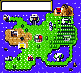 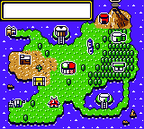

### Mason Laboratory (Dr. Mason's lab, main room) (`MASON_LABORATORY`)

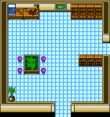 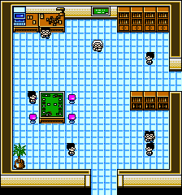 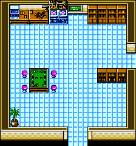

### Mason Laboratory: Deck Machine room (`DECK_MACHINE_ROOM`)

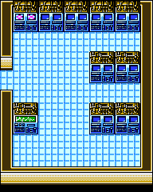 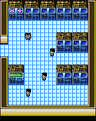 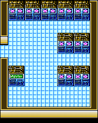

### Ishihara's House (`ISHIHARAS_HOUSE`)

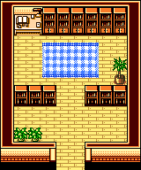 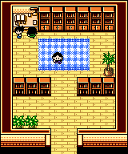

### Fighting Club: entrance (`FIGHTING_CLUB_ENTRANCE`)

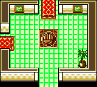 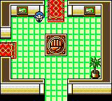

### Fighting Club: lobby (`FIGHTING_CLUB_LOBBY`)

 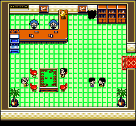

### Fighting Club: club room (`FIGHTING_CLUB`)

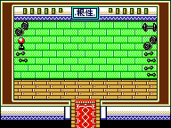 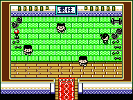

### Rock Club: entrance (`ROCK_CLUB_ENTRANCE`)

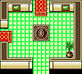 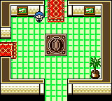

### Rock Club: lobby (`ROCK_CLUB_LOBBY`)

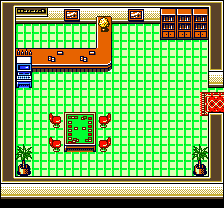 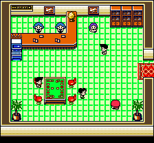

### Rock Club: club room (`ROCK_CLUB`)

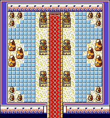 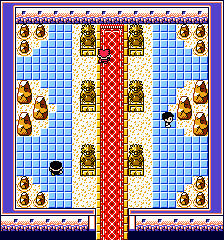

### Water Club: entrance (`WATER_CLUB_ENTRANCE`)

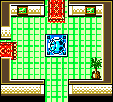 

### Water Club: lobby (`WATER_CLUB_LOBBY`)

 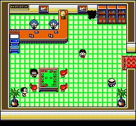

### Water Club: club room (`WATER_CLUB`)

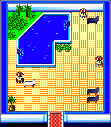 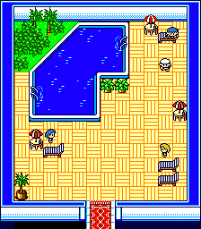

### Lightning Club: entrance (`LIGHTNING_CLUB_ENTRANCE`)

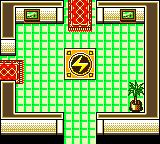 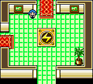

### Lightning Club: lobby (`LIGHTNING_CLUB_LOBBY`)

 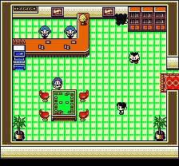

### Lightning Club: club room (`LIGHTNING_CLUB`)

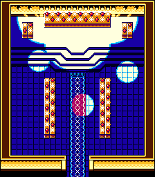 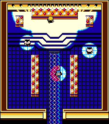

### Grass Club: entrance (`GRASS_CLUB_ENTRANCE`)

 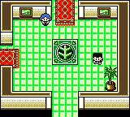

### Grass Club: lobby (`GRASS_CLUB_LOBBY`)

 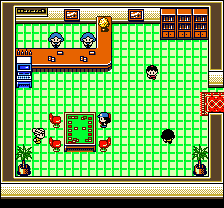

### Grass Club: club room (`GRASS_CLUB`)

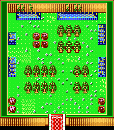 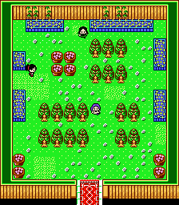

### Psychic Club: entrance (`PSYCHIC_CLUB_ENTRANCE`)

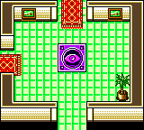 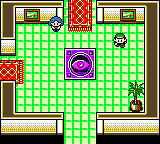

### Psychic Club: lobby (`PSYCHIC_CLUB_LOBBY`)

 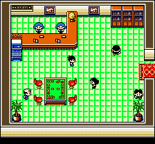

### Psychic Club: club room (`PSYCHIC_CLUB`)

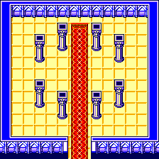 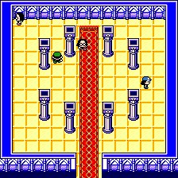

### Science Club: entrance (`SCIENCE_CLUB_ENTRANCE`)

 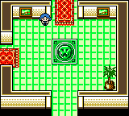

### Science Club: lobby (`SCIENCE_CLUB_LOBBY`)

 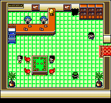

### Science Club: club room (`SCIENCE_CLUB`)

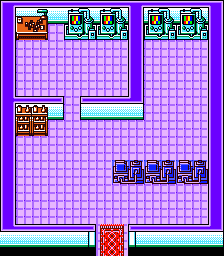 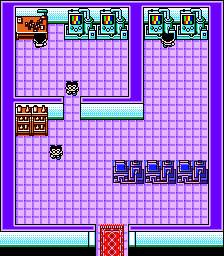

### Fire Club: entrance (`FIRE_CLUB_ENTRANCE`)

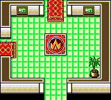 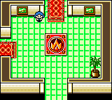

### Fire Club: lobby (`FIRE_CLUB_LOBBY`)

 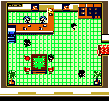

### Fire Club: club room (`FIRE_CLUB`)

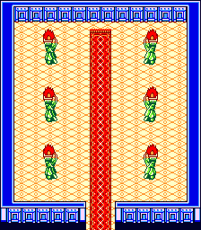 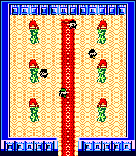

### Challenge Hall: entrance (`CHALLENGE_HALL_ENTRANCE`)

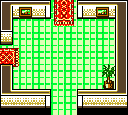 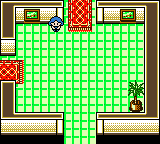

### Challenge Hall: lobby (`CHALLENGE_HALL_LOBBY`)

 

### Challenge Hall: hall (Challenge Cup) (`CHALLENGE_HALL`)

 

### Pokémon Dome: entrance (`POKEMON_DOME_ENTRANCE`)

 

### Pokémon Dome: Grand Masters hall (`POKEMON_DOME`)

  

### Pokémon Dome: Hall of Honor (`HALL_OF_HONOR`)

 
