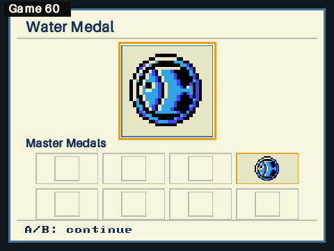
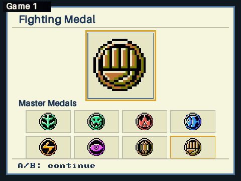

# Original-art medal rewards

`adventure_show_medal(event, state)` now presents all eight Master Medal awards
with their original CGB artwork. The new medal has a72px logical hero above
the original4×2 collection order, with a gold highlight. Uncollected slots stay
empty. The awarded medal remains visible throughout; the highlight pulses at
the original16-VI cadence. After the original225-VI celebration, `A/B: continue`
appears and requires a fresh press. The screen keeps rendering until any
remaining fanfare finishes, then restores the paused room song.

Root integrated the presenter in `OW_FEATURE_MEDAL`. The presenter receives a
const `OwState` and only reads the already-recorded collection flags. It does
not grant medals, update counts, save, generate boosters or call world drawing.

## Source mapping and artwork

Authority: `src/engine/menus/medal.asm`, `print_stats.asm`, `MedalGfx` in
`src/gfx.asm`, the eight CGB medal tilemaps and `MedalsPal`.

| Award event | Medal | Collection bit | Source tilemap | Palette |
| --- | --- | --- | --- | --- |
|08 Nikki | Grass |80 |3E |1 |
|09 Rick | Science |40 |3F |1 |
|0A Ken | Fire |20 |40 |2 |
|0B Amy | Water |10 |41 |3 |
|0C Isaac | Lightning |08 |42 |4 |
|0D Murray | Psychic |04 |45 |6 |
|0E Gene | Rock |02 |44 |5 |
|0F Mitch | Fighting |01 |43 |5 |

The final three tilemaps are deliberately non-linear. `MedalGfx` rearranges the
source sheet into VRAM, and Psychic uses non-contiguous tiles. The builder
decodes the assembled graphics and original3×3 tilemaps, with the six palettes
loaded at BG index1. All four source colors, including the cream background,
remain unchanged in each opaque24×24 PNG. No generated/redrawn artwork is used.

`assets/medals/manifest.json` pins asset hashes, source hashes, event/bit mapping,
tilemap/palette identities and the four original colors. Its checker runs on a
fresh checkout without needing the built Game Boy ROM; regeneration uses the
existing ROM/symbol source readers.

## Verification

- Host:2,048 event/collection/layout combinations plus two fresh A/B/fanfare
  sequences pass, with warnings treated as errors; ASan/UBSan also pass.
- Native4MiB at320×240 and8MiB at480×360 pass in private Ares instances.
- At each resolution, all8 enlarged designs match **4,608 original source
  texels exactly**, sampled from completed RDP output.
- At each resolution, **21,312 collection-icon texels** also match the source
  exactly across all8 prefix collections and the live Water-only award. This
  includes all8 small icons in the full collection; Water is present in the
  top-right slot. No production change was needed after the visual recheck.
- The live Water reward keeps rendering while real `MUSIC_MEDAL` plays.
  Holding A across entry and the celebration cannot dismiss it; release and a
  fresh B acknowledge it. Room music stays paused at its exact fractional
  sample position, and resumes only after the fanfare ends.
- Complete `OwState`, WRAM and HRAM snapshots are byte-identical afterward.
- The module fences RDP reads before freeing sprites/canvas, paints through the
  cached CPU alias, writes back before RDP texture reads, and caches each
  composition until the pulse or continue hint changes.

The native harness is isolated from production `main`, uses private settings
and saves, and pins its engine/audio/queue objects. It includes the actual
production fonts/video code and the medal module. It does not load all world
models or claim a new worst-case full-game heap measurement. Native gates took
11.72s and17.24s respectively, with no emulator left running.

The PNGs below are completed **raw N64 RDP framebuffers**, captured inside Ares
after fences. VI processing was enabled for playback, but these are not
post-VI output screenshots. Detailed result files and compact logs are beside
the images; the original full pixel logs remain in the ignored private build.

|320×240 Water award |480×360 Water award |
| --- | --- |
|  |  |



## Reproduction

```sh
python3 port/frontends/n64/adventure/tools/build_medals.py --check
cc -std=c11 -Wall -Wextra -Werror -Iport/src \
  port/frontends/n64/adventure/tests/medal_flow.c -o /tmp/poketcg-medal-flow
/tmp/poketcg-medal-flow
# Coordinate the shared native-emulator slot before running these:
python3 port/frontends/n64/adventure/tools/review_medals.py --build
python3 port/frontends/n64/adventure/tools/review_medals.py --case 4mib
python3 port/frontends/n64/adventure/tools/review_medals.py --case 8mib
```

The native gate's build assumes the regular adventure engine/audio objects and
filesystem have already been built. Normal ROM builds pack the checked-in
medal PNGs and do not need the original Game Boy ROM or Pillow at runtime.
