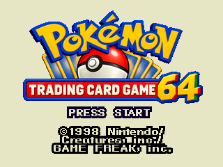
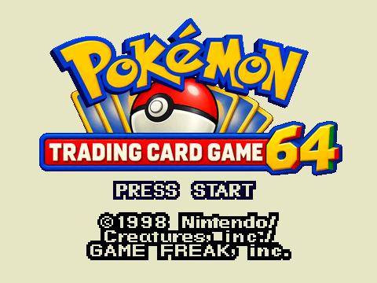

# Pokémon Trading Card Game 64 title

The actual N64 title screen now displays **Pokémon Trading Card Game 64** with
the generated transparent logo. It sits above the original blinking Press
Start prompt and original copyright footer. The three opening scenes, energy
orb tables/coordinates, music triggers, fades, button actions and replay loop
remain unchanged.

## Artwork and packing

Source artwork: `port/frontends/n64/adventure/assets/title64/source.png`.
It was created with the built-in `image_gen` tool using the original GBC
`assets/intro/title.png` as reference. The exact generation prompt and
provenance are preserved in `assets/title64/prompt.txt`. No additional image
generation was used for the integration.

`tools/build_title64.py` creates two derivatives without redrawing:280×140
for320×240, and420×210 for480×360. The resize operates on premultiplied
RGB/alpha, then stores straight-alpha PNGs and bleeds neighboring edge RGB
into zero-alpha pixels to avoid dark bilinear fringes. The asset test verifies
determinism, dimensions, hashes, title metadata, source/reference provenance,
layout bounds, and identical output for synthetic images with different hidden
transparent RGB.

Only the selected resolution's sprite is loaded at runtime:78,400 or176,400
bytes of RGBA16 image data. The Makefile packs the two explicit derivative
filenames and excludes the1774×887 editable source from the ROM. The original
`intro/title.png` and its extraction manifest remain unchanged; its source
rows110–144 are still drawn for the copyright footer.

## Native verification

Both private Ares gates pass, at320×240 with4MiB and480×360 with8MiB:

- **748,800 opening pixels** across the three original scenes match the prior
  renderer exactly, using the old and new renderer in the same ELF.
- **39,600 copyright pixels** match the prior renderer exactly.
- The original source animation checks pass, including wrapped coordinates,
  stopped/hidden frames,78-tick title arrival and white-fade boundaries.
- Three actual input routes pass per resolution: early A then Start, early
  Start then A, and skipping the opening with A then continuing with Start.
  Early title input remains ignored until the existing60-tick gate; each exit
  produces the existing confirm sound and fade.
- Real title music plays throughout these actual loops. Music stop/start and
  confirm events retain their counts; WRAM and HRAM stay byte-identical.
- Both existing intro-asset checks and new title-asset checks pass. The
  original12 images and26 animation tables remain intact.

The native harness owns private ROM/ELF/DFS/settings/save paths and pins its
engine/audio/queue objects. The prior renderer is pinned to commit
`1ededb5d53411f26d5741af81337262552edebc6` for reproducibility after integration.
The default FPS overlay is disabled for these art captures using the existing
`ADVENTURE_SHOW_FPS=0` switch. No emulator is left running.

Images are completed **raw N64 RDP framebuffers**, read after fences inside
Ares. Playback has VI processing enabled; these PNGs precede VI output
filtering. They are not post-CRT trailer frames. The separate trailer capture
uses the integrated title in the real emulator presentation path.

|320×240 |480×360 |
| --- | --- |
|  |  |

The prompt-off and original Charizard reference captures are beside each
image, with result JSON and compact logs. The full pixel logs remain in the
ignored private build.

## Reproduction

```sh
python3 port/frontends/n64/adventure/tools/build_title64.py --check
python3 port/frontends/n64/adventure/tools/build_intro.py --check
# Coordinate native runs before starting Ares:
python3 port/frontends/n64/adventure/tools/review_title64.py --build
python3 port/frontends/n64/adventure/tools/review_title64.py --case 4mib
python3 port/frontends/n64/adventure/tools/review_title64.py --case 8mib
```

The private native build assumes the regular adventure engine/audio objects
and original intro filesystem already exist. Normal ROM builds use the
checked-in derivative PNGs and generated header; they do not load or resize
the large source image at runtime.
